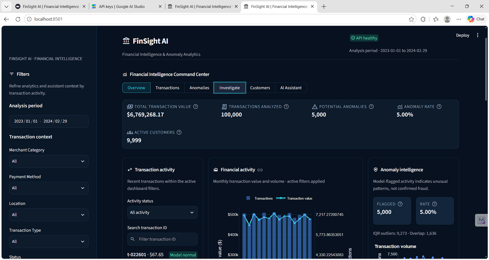
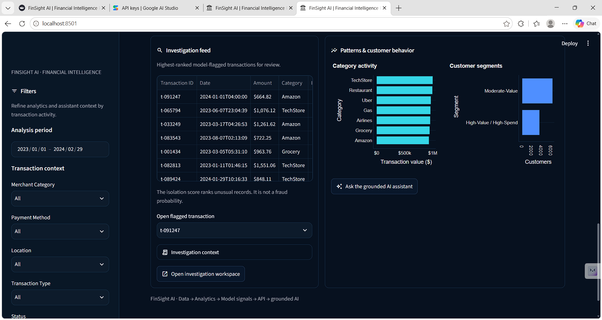
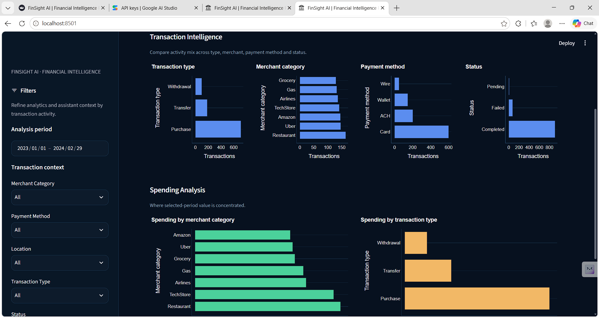
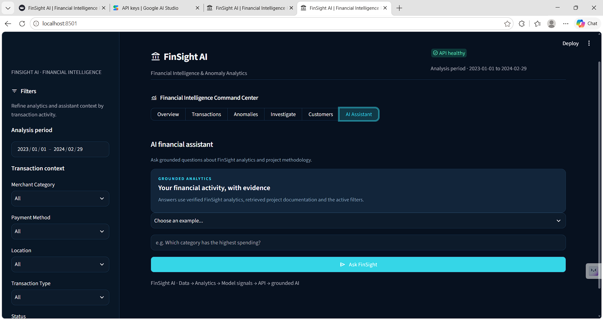

# FinSight AI

FinSight AI is a financial transaction analytics project, implementing stages from data profiling up to full AI analytics.

## Current Stage: Stage 07 (Fraud and Anomaly Validation)

This project implements a **FastAPI** backend and **Streamlit** dashboard over processed data, with a grounded assistant, local documentation retrieval, reproducible anomaly scoring, synthetic-label benchmarking, and transaction investigation.

### Architecture

```
Streamlit Dashboard (Frontend)
        ↓ (HTTP/REST)
FastAPI REST API (Backend)
        ↓
Data Service / Analytics Service
        ↓
Processed FinSight AI Datasets (CSV)
```

### Dashboard Screenshots

| Overview | Investigation |
| --- | --- |
|  |  |

| Transaction intelligence | AI assistant |
| --- | --- |
|  |  |

**Technology Stack:**
- **Backend**: FastAPI, Uvicorn, Pandas
- **Frontend/Dashboard**: Streamlit, Plotly
- **Data Source**: Validated outputs from Stages 1-4 (`transactions_cleaned.csv`, `transactions_with_anomalies.csv`, `customer_segments.csv`)
- **Testing**: Pytest, HTTPX

### Local Startup Instructions

*Important: The dashboard relies entirely on the API. The API must be running first.*

#### 1. Install Dependencies
```bash
pip install -r requirements.txt
```

#### 2. Start the FastAPI Backend
```bash
# From the root directory (FinSight-AI)
uvicorn api.main:app --reload
```
The API will be available at `http://localhost:8000`. You can view the swagger documentation at `http://localhost:8000/docs`.

#### 3. Start the Streamlit Dashboard
```bash
# In a new terminal window, from the root directory
streamlit run dashboard/app.py
```
The dashboard will open in your browser, typically at `http://localhost:8501`.

### API Endpoints

- `GET /health`: System health check
- `GET /api/kpis/`: High-level metrics
- `GET /api/transactions`: Filterable transaction list
- `GET /api/transactions/recent`: Most recent transactions
- `GET /api/trends/monthly`: Time-series aggregations
- `GET /api/anomalies/`: List of flagged anomalies
- `GET /api/anomalies/summary`: Statistics on detection overlap
- `GET /api/customers/top`: Highest value customers
- `GET /api/segments`: Customer clustering output
- `GET /api/segments/summary`: Segment profiles
- `GET /api/categories`, `/api/payment-methods`, `/api/locations`: Metadata for filters
- `POST /api/ai/query`: Grounded natural-language FinSight analytics

Example request:
```json
{
        "question": "Which merchant category has the highest spending?",
        "filters": {"date_from": "2023-01-01", "date_to": "2024-02-29"}
}
```

### AI Assistant Setup

The assistant routes numerical questions to existing FinSight analytics services. Documentation questions search the local Markdown index and send the matching excerpts, source paths, and headings to the configured LLM. The dashboard's current filters are passed to analytics questions.

The retriever uses scikit-learn's local `HashingVectorizer` (word and bigram vectors) and SQLite. It adds no model download, paid embedding service, or new package. The vectors are lexical, so semantically similar terms that share few words may not match.

1. Set `FINSIGHT_LLM_PROVIDER=gemini` and `GEMINI_API_KEY` for Google Gemini. The default Gemini model is `gemini-3.8-flash`; override it with `FINSIGHT_LLM_MODEL` when needed. For OpenAI, omit the provider setting or use `FINSIGHT_LLM_PROVIDER=openai` with `FINSIGHT_LLM_API_KEY` or `OPENAI_API_KEY` (default model `gpt-4o-mini`). The service reads process environment variables; a plain `.env` file is not loaded automatically.
2. Optionally set `FINSIGHT_LLM_BASE_URL` to override the selected provider's OpenAI-compatible chat completions URL.
3. Build or refresh the local documentation index after changing documentation:

```bash
python -m api.assistant.index_documents
```

An empty or outdated index is also rebuilt automatically when a documentation question arrives. Local index settings are documented in [docs/ai_assistant.md](docs/ai_assistant.md).

4. Start FastAPI, then start Streamlit using the commands above.

Without LLM credentials, analytics APIs and the dashboard continue to work, while AI queries return HTTP 503 with a configuration message. Do not put API keys in source files.

### Testing Instructions

Run the automated test suite to verify API logic and local retrieval without a paid API:
```bash
# From the root directory
python -m pytest api/tests/ -q
```

### Current Limitations
- The underlying anomalies are *potential anomalies* (unsupervised ML). They are NOT verified fraud.
- Data is currently loaded from static CSV files (Stage 1-4 outputs).

Financial numbers continue to come from FinSight analytics services. See [docs/ai_assistant.md](docs/ai_assistant.md) for the Stage 06B architecture, settings, and grounding rules.

### Stage 07: Validation and Investigation

The transaction pipeline validates raw transactions, removes exact duplicate rows, engineers the existing notebook features, scores potential anomalies with the existing Isolation Forest configuration, and atomically writes processed CSV and a run summary. Generate the audit report with `python -m api.pipeline.audit`; run the pipeline with:

```bash
python -m api.pipeline --input data/raw/transactions.csv --output data/processed/transactions_with_anomalies.csv --report data/processed/pipeline_summary.json --customers data/raw/customers.csv
```

The dashboard's **Investigate** tab searches and filters transaction records, sorts by anomaly score, and exports matching records to CSV through the API. `GET /api/quality/summary` reports data quality and `GET /api/anomalies/evaluation` returns a synthetic-label comparison when available. The synthetic labels are randomized generator heuristics, not verified fraud. On the checked-in data, the benchmark compared 100,000 rows: precision 0.0332, recall 0.0594, F1 0.0426, and false-positive rate 0.0497. These are not real-world fraud performance measures. See [docs/stage07.md](docs/stage07.md) and [docs/stage07_dataset_audit.json](docs/stage07_dataset_audit.json) for the methodology and full audit.
